Ce guide explique comment importer un fichier Excel dans la base via
l'assistant d'import, comment suivre les imports dans le tableau de bord,
et comment gérer les règles de validation par entité.

Les captures d'écran montrent l'interface, dont les libellés sont en anglais ;
les légendes et explications ici sont en français.

> Fichiers d'exemple : `docs/sample-data/` (voir son `README.md`).
> Parcours conseillé pour une première prise en main :
> `lignes_rejetees_demo.xlsx` (60 lignes, dont 20 délibérément rejetées,
> pour voir le rapport). Un fichier `comptes_clients_2000.xlsx` sert
> d'essai de volume.

## Prérequis

- Être connecté à l'application. Compte de développement pré-rempli :
  `admin@localhost`.

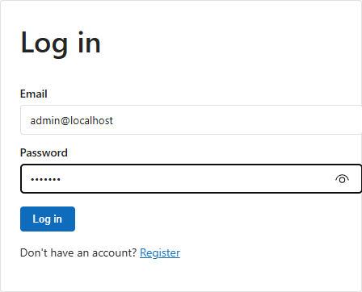{width=55%}

- Disposer d'un fichier **`.xlsx`** (seul format accepté, 100 Mo maximum).
- Connaître l'entité métier cible (ex. `ClientAccounts`).

## L'assistant en 5 étapes

L'assistant est un parcours en 5 étapes. Chaque étape se **confirme**
explicitement ; revenir sur une étape terminée puis la re-confirmer
réinitialise les étapes suivantes (jamais les précédentes).
Changer d'entité cible réinitialise le mapping, mais **pas** le fichier envoyé.

### 1. Entité cible

Choisir l'entité à alimenter dans la liste, vérifier l'aperçu du schéma
(champs, types, contraintes), puis confirmer.

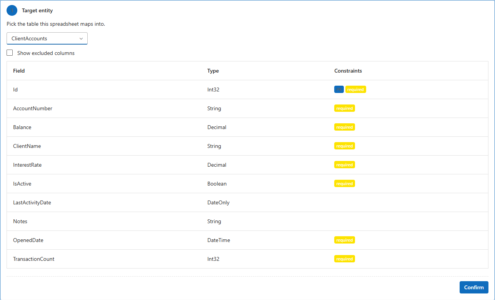{width=90%}

### 2. Envoi du fichier

Déposer le fichier `.xlsx`. Il est analysé dans le navigateur (aperçu des
50 premières lignes, hors thread principal). Si le classeur contient
**plusieurs feuilles**, choisir la feuille à importer dans le sélecteur,
puis confirmer.

{width=90%}

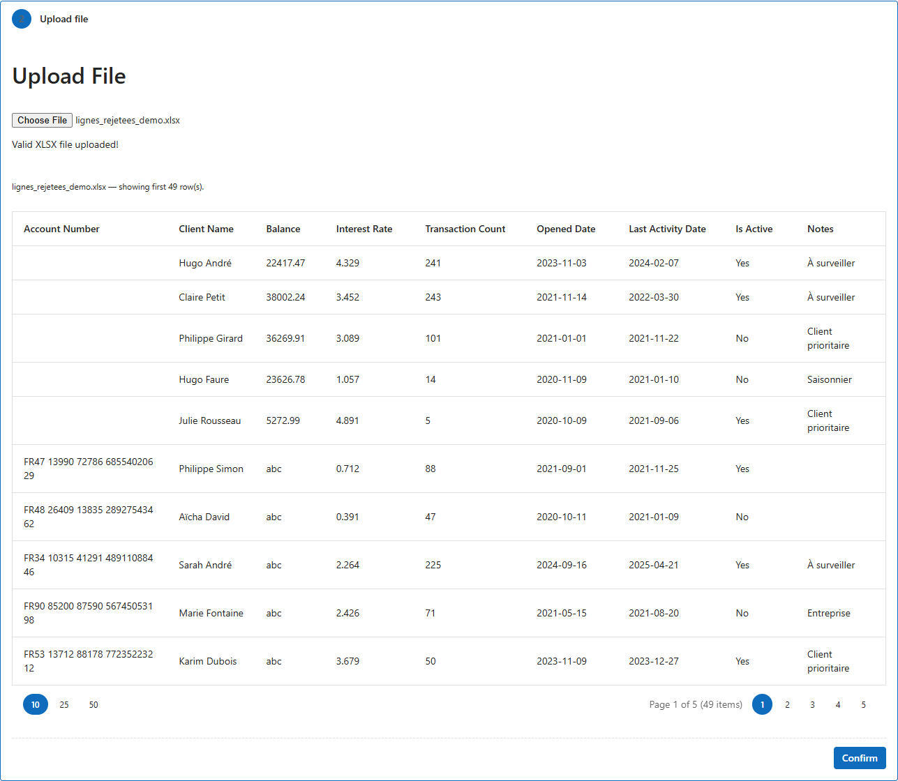{width=90%}

### 3. Correspondance des colonnes (mapping)

- Les colonnes Excel sont **rapprochées automatiquement** par nom
  (`AccountNumber` ↔ `AccountNumber`). Ajuster les associations restantes
  dans le tableau ; chaque champ base ne peut être utilisé qu'une fois.
- **Champ obligatoire** : cocher « required » pour les colonnes qui doivent
  impérativement avoir une valeur sur chaque ligne (ex. n° de compte).
- **Formats** selon le type du champ : format de date (`yyyy-MM-dd`,
  `dd/MM/yyyy`, …), heure, séparateur décimal (point/virgule, symboles
  monétaires à ignorer), libellés booléens (ex. vrai = `Oui`, faux = `Non`).
  La détection est automatique quand l'échantillon est sans ambiguïté ;
  dans le cas contraire, la ligne affiche un signal « à configurer ».

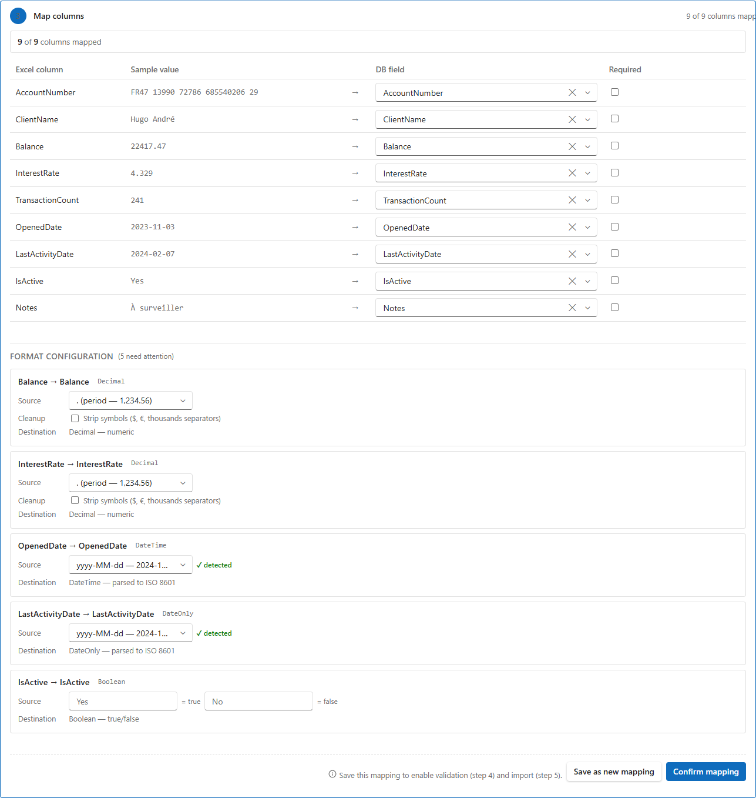{width=90%}

- Confirmer le mapping, puis **enregistrer le mapping sous un nom** (soit
  avant, soit après la confirmation). La validation (étape 4) et l'import
  (étape 5) **exigent un mapping enregistré** : tant qu'aucun mapping
  n'est sélectionné, leurs boutons restent inactifs, et l'assistant
  l'indique plutôt que de laisser deviner.

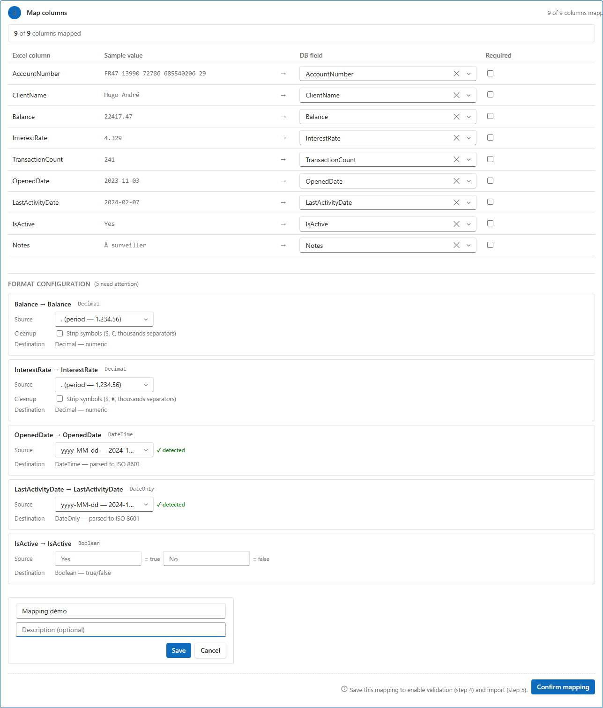{width=70%}

Un mapping enregistré peut être rechargé plus tard. Modifier une ligne
du mapping (champ, obligatoire, formats) **invalide le mapping enregistré**
et le rapport de validation : il faut re-sauvegarder puis re-valider.
Le nom d'un mapping doit être unique par entité cible.

### 4. Aperçu et validation

- L'aperçu montre les valeurs **transformées** (telles qu'elles seront
  importées avec les formats de l'étape 3).
- Choisir le traitement des **champs obligatoires vides** dans le
  sélecteur de cette étape : *Reject entire import* (rejette le lot),
  *Skip rows* (ignore la ligne), *Default* (valeur par défaut du type).
  Ce choix s'applique à la validation **et** à l'import ; changer de mode
  efface le rapport de validation courant (il faut re-valider).
- Lancer la **validation** : le serveur rejoue exactement le même traitement
  que l'import sur tout le fichier, sans rien écrire en base. Le rapport
  indique les effectifs et, pour chaque rejet, la ligne et le motif ;
  le détail est téléchargeable en CSV.
- **Import impossible sans validation** : tant qu'aucun rapport n'existe,
  le bouton d'import reste inactif. Avec le mode *Skip rows* ou *Default*,
  un import avec rejets reste possible (bandeau d'avertissement) ; les lignes
  écartées sont tracées dans le journal du lot.
- La liste des règles actives de l'entité est affichée en lecture seule
  (voir la section Règles de validation) : ici aucune règle active.

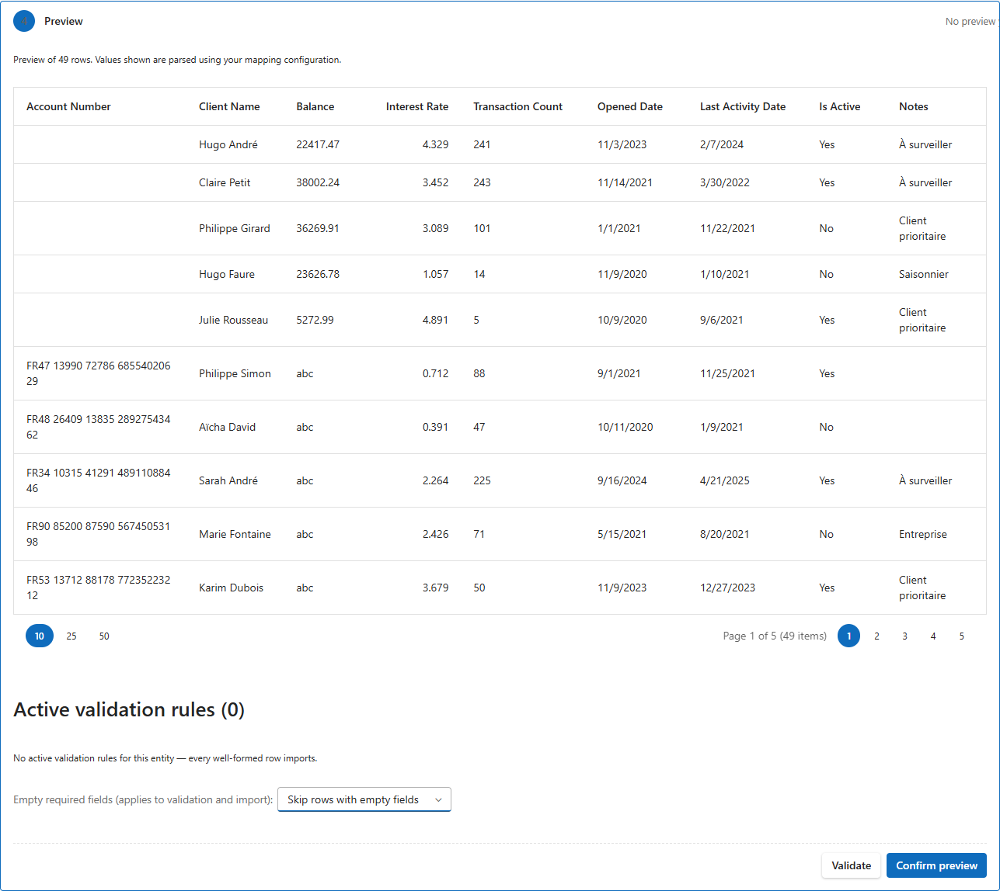{width=90%}

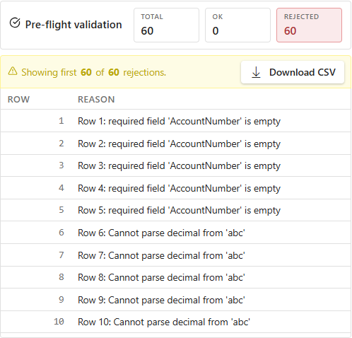{width=90%}

Essai conseillé : `lignes_rejetees_demo.xlsx` avec le mode *Skip rows*
affiche 40 acceptées / 20 rejetées (5 sans n° de compte, 5 montants
invalides, 5 dates invalides, 5 booléens invalides).

### 5. Vérification et import

- Relire le résumé (entité, fichier, mapping, mode choisi, effectifs).
- Lancer l'**import** : le fichier est envoyé au serveur puis traité en
  tâche de fond (progression périodique, rafraîchie sous la seconde).
  Ce qui arrive en cas de problème dépend du mode choisi à l'étape 4 :
  *Reject entire import* refuse le lot entier, *Skip rows* n'écarte que
  les lignes fautives et écrit les bonnes. Un lot qui échoue passe en
  `Failed` (conservé pour audit, jamais supprimé).
- Quand des lignes ont été écrites, le **rapport d'import** final donne
  les lignes importées / rejetées avec les motifs, et chaque ligne
  importée reste rattachée à son lot (traçabilité). Pour un lot `Failed`,
  ce rapport n'existe pas : c'est le motif du lot (ci-dessus) qui fait foi. Distinction à retenir : une ligne **rejetée** a un motif
  (champ obligatoire vide, valeur illisible) et reste dans le journal ;
  une ligne **sautée** ne s'est pas écrite pour la raison choisie à
  l'étape 4 (*Skip rows*). Les deux lignes n'atteignent pas la table :
  le même compteur du lot les regroupe côté affectatif.
- Après la fin de l'import, le journal des lignes est envoyé par blocs
  sur le serveur : pendant ce court laps de temps, le lot affiche une
  pastille « journal en cours d'envoi ». Si l'envoi échoue, le lot est
  marqué journal incomplet : les motifs des lignes manquantes ne sont
  plus récupérables, le fichier source ayant été supprimé. La mécanique
  exacte est décrite dans la [documentation technique](documentation-technique.md#sec-import).
- **Un lot `Failed` n'a pas de journal** (il n'écrit rien, donc le
  journal n'existe pas) : son motif est enregistré sur le lot et
  affiché par l'assistant, et la colonne « Reason » du tableau de bord
  (masquée par défaut) le rend lisible aussi.

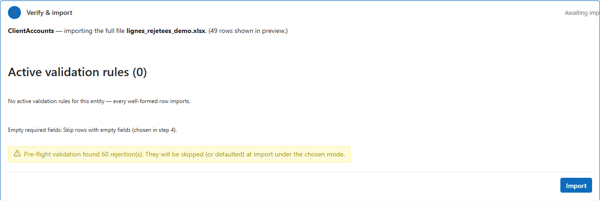{width=90%}

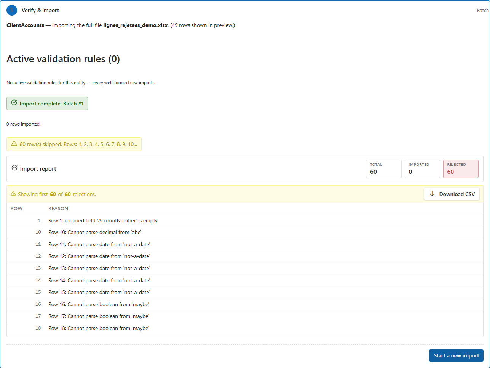{width=90%}

## Tableau de bord des imports

- **Filtres** : recherche (nom de fichier, utilisateur), statut, table cible,
  période (boutons 24 h / 7 j / 30 j), taille de page. Les filtres actifs
  s'affichent en pastilles, retirables une par une.

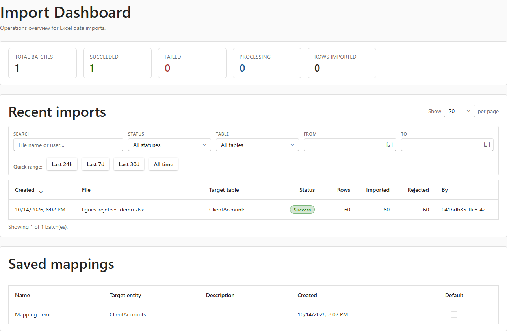{width=90%}

- **Journal d'un lot** : cliquer un lot pour voir ses lignes une par une
  (`Importées` / `Rejetées`), avec le motif de chaque rejet. L'affichage
  des données brutes (payload) est masqué par défaut.
- Tant qu'un lot est en cours, la page se rafraîchit périodiquement
  (toutes les 2 secondes) ; ce n'est pas du temps réel strict, et les
  vues filtrées ne sont pas perturbées par ce rafraîchissement.

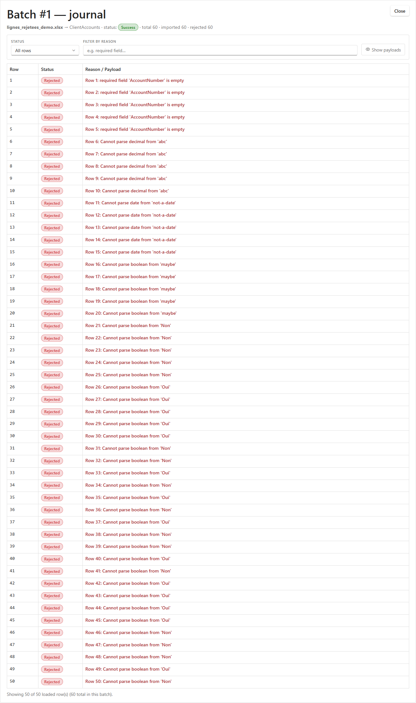{width=90%}

## Règles de validation par entité

La page **Validation rules** définit des règles métier par entité :
une ligne n'est importée que si elle satisfait toutes les règles actives
de l'entité. Une cellule vide passe outre la règle : l'obligation de
remplissage est portée par le mapping, pas par les règles.

- Les règles s'énoncent **Field + Operator + valeur** : constante exacte
  (égalité/comparaison/liste `In`), ou fonction horaire (aujourd'hui,
  aujourd'hui moins N années, etc.), évaluée en UTC au moment de l'import.
- **Quick setup** propose des modèles d'intention (âge minimal/maximal,
  date récente de N jours, valeur min/max, appartenance à une liste) ;
  le mode détaillé reste disponible pour régler chaque champ à la main.
  Après application d'un modèle, le formulaire bascule automatiquement
  en mode détaillé pour vérifier avant enregistrement.
- Une règle se **désactive** (case Active) et n'est jamais supprimée :
  ainsi les rapports des lots passés restent explicables.
- Les modifications s'appliquent aux imports **futurs** de l'entité, sans
  exception par mapping.

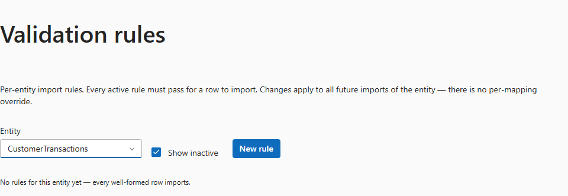{width=90%}

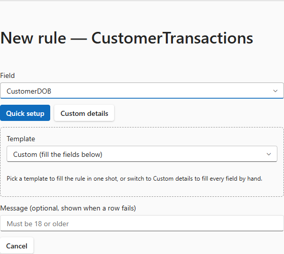{width=90%}

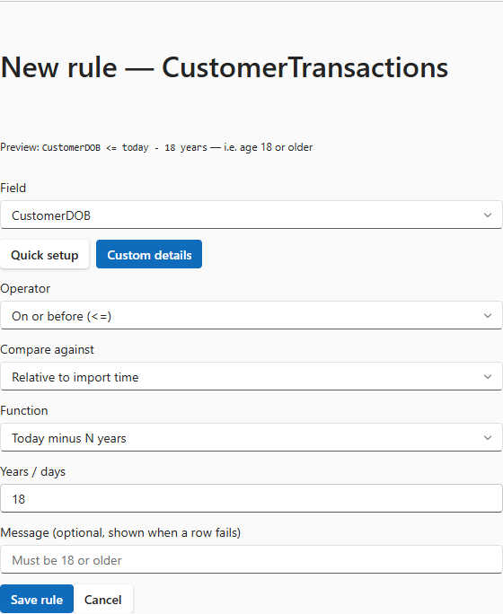{width=90%}

## En cas d'erreur

| Message / symptôme | Cause probable | Action |
|---|---|---|
| Fichier refusé à l'envoi | Pas un `.xlsx`, ou > 100 Mo | Convertir en `.xlsx`, réduire le fichier |
| `required field 'X' is empty` | Colonne obligatoire vide sur la ligne | Corriger le fichier, ou choisir *Skip rows*/*Default*, ou décocher « required » |
| `Cannot parse decimal/date/boolean` | Format non conforme (séparateur, ordre jour/mois, libellé booléen) | Régler les options de format (étape 3) |
| Validation impossible (bouton inactif) | Aucun mapping enregistré | Enregistrer le mapping (étape 3) |
| Import impossible (bouton inactif) | Validation pas encore lancée, ou rejets sous le mode *Reject entire import* | Valider (étape 4), corriger, ou changer de mode |
| Un mapping du même nom existe déjà | Nom déjà pris pour cette entité | Choisir un autre nom (unicité par entité) |
| Lot `Failed` | Erreur bloquante (ex. colonne mappée absente du fichier) | Lire le motif porté par le lot (assistant ou pastille « Reason »), corriger, relancer |
| `Mapping … not found` (404) | Mapping supprimé entre-temps | Re-créer ou recharger le mapping |
| Import qui échoue bruyamment sur une règle | Champ de l'entité disparu (dérive de schéma) : la règle est incalculable et le lot est arrêté | Corriger ou désactiver la règle sur la page des règles |

## Règle d'or

**Rien n'est écrit en base sans validation humaine** : l'aperçu (étape 4)
puis l'écran de vérification (étape 5) sont les deux points de contrôle
obligatoires. Changer de mode ou de mapping efface le rapport : re-valider
avant d'importer. En cas de doute, relancer la validation plutôt que
l'import.
